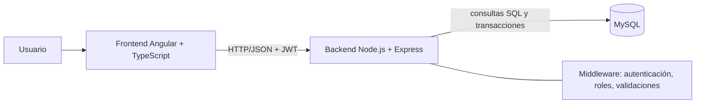
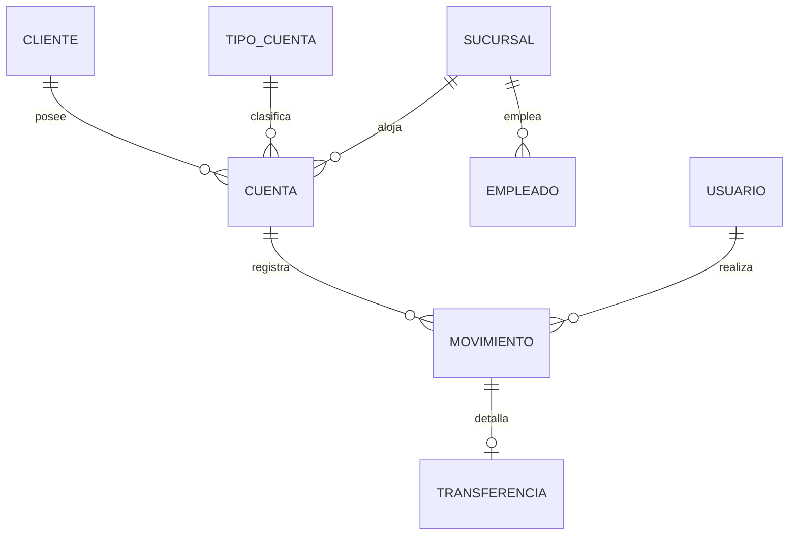
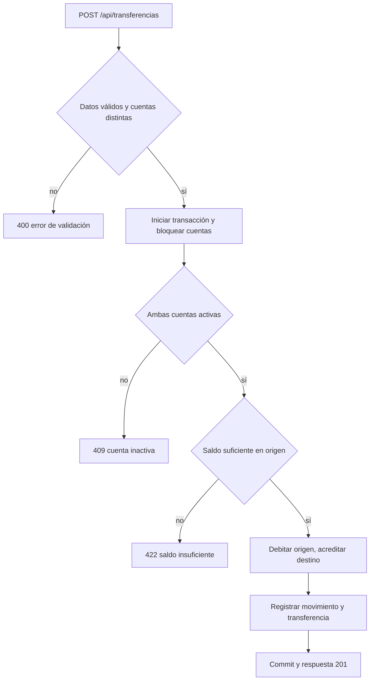

# Documentación del proyecto — Sistema Bancario (Taller 2)

> Completar los campos marcados con **[COMPLETAR]** antes de entregar.

| Dato | Información |
| ---- | ----------- |
| Institución | Fundación Kinal |
| Curso / Área | Taller 2 |
| Grado y sección | 5to "C" |
| Docente | Eduardo Hor |
| Integrante | Cristopher Giovanni López Díaz (carné 2021325) |
| Fecha de inicio / entrega  / 18/11/2026 |
| Repositorio GitHub | https://github.com/Cristopher2021325/Taller_Nivelacion |

## 1. Problema y solución

Una entidad bancaria académica necesita gestionar clientes, cuentas y operaciones financieras simuladas con datos ficticios.
La solución es una aplicación web con **Angular** (frontend), **Node.js + TypeScript + Express** (API REST con JWT) y
**MySQL** (base de datos), con operaciones atómicas mediante transacciones SQL.

## 2. Objetivos

- Gestionar clientes y cuentas (registrar, consultar, modificar, desactivar).
- Registrar depósitos, retiros y transferencias aplicando las reglas de negocio.
- Consultar el historial de movimientos y un reporte de operaciones.
- Controlar el acceso por rol (admin / usuario de consulta).

## 3. Requerimientos

**Funcionales**

| ID | Requerimiento |
| -- | ------------- |
| RF01 | Iniciar y cerrar sesión con credenciales ficticias |
| RF02 | Registrar, consultar, modificar y desactivar clientes |
| RF03 | Crear cuentas asociadas a un cliente y consultar su saldo y estado |
| RF04 | Registrar depósitos y actualizar el saldo |
| RF05 | Registrar retiros validando el saldo disponible |
| RF06 | Transferir entre cuentas y registrar la operación |
| RF07 | Consultar el historial de movimientos (general y por cuenta) |
| RF08 | Buscar clientes y cuentas |
| RF09 | Mostrar un reporte de operaciones |

**No funcionales:** contraseñas cifradas (bcrypt), tokens JWT con expiración, validación en frontend y backend,
transacciones SQL, solo datos ficticios, separación frontend / backend / base de datos.

**Reglas de negocio:** (1) toda cuenta pertenece a un cliente; (2) no retirar más que el saldo; (3) y (4) montos mayores a cero;
(5) transferencia con cuentas origen y destino válidas; (6) origen con saldo suficiente; (7) no transferir a la misma cuenta;
(8) toda operación se registra con fecha, tipo, monto y cuentas; (9) cuenta inactiva no opera; (10) solo información ficticia.

## 4. Historias de usuario

| ID | Historia | Requerimiento |
| -- | -------- | ------------- |
| HU01 | Como administrador, quiero iniciar sesión para acceder al sistema de forma segura. | RF01 |
| HU02 | Como administrador, quiero registrar un cliente para poder abrirle cuentas. | RF02 |
| HU03 | Como administrador, quiero desactivar un cliente para que ya no opere sin perder su historial. | RF02 |
| HU04 | Como administrador, quiero crear una cuenta asociada a un cliente para que pueda guardar dinero. | RF03 |
| HU05 | Como cajero, quiero registrar un depósito para actualizar el saldo de una cuenta. | RF04 |
| HU06 | Como cajero, quiero registrar un retiro validando el saldo para evitar saldos negativos. | RF05 |
| HU07 | Como cajero, quiero transferir dinero entre dos cuentas para mover fondos de forma segura. | RF06 |
| HU08 | Como usuario de consulta, quiero ver el historial de movimientos de una cuenta para conocer sus operaciones. | RF07 |
| HU09 | Como usuario de consulta, quiero buscar clientes y cuentas para encontrarlos rápido. | RF08 |
| HU10 | Como gerente, quiero un reporte de operaciones por tipo para supervisar la actividad. | RF09 |
| HU11 | Como administrador, quiero que una cuenta inactiva no permita operaciones para evitar movimientos no autorizados. | Regla 9 |
| HU12 | Como usuario de consulta, quiero que el sistema me impida registrar datos para que solo el administrador modifique información. | RF01 |

## 5. Arquitectura

Capas del backend: **routes → controllers → services → base de datos** (`backend/src`).

## 6. Modelo de datos

Entidades: `usuario`, `cliente`, `tipo_cuenta`, `sucursal`, `empleado`, `cuenta`, `movimiento`, `transferencia`.
Ver `docs/diagrama-er.png` (actualizar con `movimiento` y `transferencia`) y `sistema_bancario_mysql.sql`.

## 7. Casos de uso y flujo de una transferencia

Actores y casos de uso: **Administrador** (autenticación, CRUD de clientes y cuentas, depósitos, retiros, transferencias, reportes);
**Usuario de consulta** (autenticación, búsquedas, movimientos, reportes).

## 8. Credenciales ficticias de prueba

| Usuario | Contraseña | Rol |
| ------- | ---------- | --- |
| admin | admin123 | admin |
| usuario | usuario123 | usuario (solo consulta) |

## 9. Matriz de pruebas

| ID | Prueba | Resultado esperado | Resultado obtenido | Evidencia |
| -- | ------ | ------------------ | ------------------ | --------- |
| P001 | Login válido | Permite acceso | Aprobada | `docs/evidencias/01-login.png`, Postman |
| P002 | Login inválido | Muestra mensaje de error | Aprobada | `docs/evidencias/03-login-credenciales-incorrectas.png` |
| P003 | Registrar cliente | Cliente almacenado | Aprobada | `docs/evidencias/` (clientes) |
| P004 | Crear cuenta | Cuenta asociada al cliente | Aprobada | `docs/evidencias/17-cuentas-registrar.png` |
| P005 | Depósito válido | Saldo incrementado | Aprobada (Postman) | `docs/evidencias/pruebas-postman.txt` (carpeta 9) + [COMPLETAR captura] |
| P006 | Retiro con saldo suficiente | Saldo disminuido | Aprobada (Postman) | `docs/evidencias/pruebas-postman.txt` (carpeta 9) + [COMPLETAR captura] |
| P007 | Retiro superior al saldo | Operación rechazada (422) | Aprobada (Postman) | `docs/evidencias/pruebas-postman.txt` (carpeta 9) + [COMPLETAR captura] |
| P008 | Transferencia válida | Se actualizan ambas cuentas | Aprobada (Postman) | `docs/evidencias/pruebas-postman.txt` (carpeta 9) + [COMPLETAR captura] |
| P009 | Transferencia a misma cuenta | Operación rechazada (400) | Aprobada (Postman) | `docs/evidencias/pruebas-postman.txt` (carpeta 9) + [COMPLETAR captura] |
| P010 | Cuenta inactiva | No permite operaciones (409) | Aprobada (Postman) | `docs/evidencias/pruebas-postman.txt` (carpeta 9) + [COMPLETAR captura] |

## 10. Registro de errores y correcciones

| # | Error encontrado | Causa | Corrección |
| - | ---------------- | ----- | ---------- |
| 1 | `POST /movimientos` no validaba el monto | Solo se validaba el tipo | Se agregó la validación del monto y la descripción |
| 2 | Borrar un cliente eliminaba su información | `DELETE` físico | Desactivación lógica del cliente y de sus cuentas |
| 3 | [COMPLETAR errores reales encontrados al integrar el frontend] | | |

## 11. Registro de uso de IA

| Campo | Registro |
| ----- | -------- |
| Herramienta | Claude (Anthropic) |
| Prompt | Revisar el proyecto contra la guía de Proyecto Integrador e implementar lo que falta (BD, backend, documentación) |
| Resultado | Análisis de brechas, nuevas tablas SQL, endpoints de depósitos, retiros, transferencias, movimientos y reporte, y esta documentación |
| Aplicación | Script SQL, servicios, controladores, rutas, validaciones y documentos del repositorio |
| Modificación | [COMPLETAR: qué cambiaste, ajustaste o corregiste tú] |
| Comprensión | [COMPLETAR: explica con tus palabras cómo funciona una transacción, el bloqueo `for update` y las validaciones] |

## 12. Conclusiones y recomendaciones

- El sistema integra frontend, backend y base de datos, y aplica las reglas de negocio dentro de transacciones SQL.
- Se recomienda automatizar las pruebas con Postman y mantener commits frecuentes por integrante.
- Mejoras futuras: paginación del historial, comprobantes en PDF, auditoría de accesos y migración a MySQL si el docente lo requiere.

## 13. Manual de usuario (resumen)

1. Abrir la aplicación e iniciar sesión con las credenciales de prueba.
2. **Clientes / Cuentas**: registrar, buscar, modificar o desactivar desde el menú.
3. **Operaciones**: elegir la cuenta, ingresar el monto y confirmar (depósito, retiro o transferencia).
4. **Movimientos y reportes**: consultar el historial por cuenta y el resumen de operaciones.
5. Cerrar sesión desde la barra de navegación.
